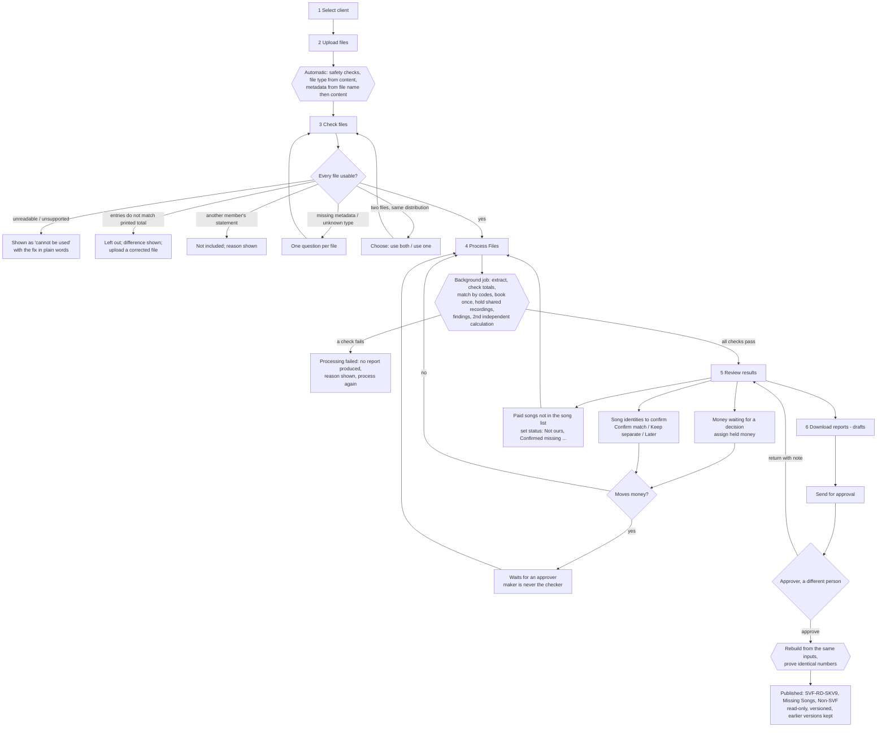

# Royalty Reports — Release 1 System Guide

| | |
|---|---|
| Date | 10 October 2026 · **version 1.0.4** (1.0.1: accounts, no demo data, light/dark theme, wider layout · 1.0.2: add clients, one-time What's new note, profile menu, My profile · 1.0.3: client and people pop-ups, removable rows, delete people without work, password confirmation, restyled drop-downs, `purge-demo` · 1.0.4: delete a run that was never published, with its drafts; the app's own drop-down lists; panel-style expandable sections) |
| Builds on | `ARCHITECTURE-V3.md` (technical foundation), `PHASE-1-AUDIT-AND-PLAN.md` (audit and questions), flowchart approval draft v1.0 |
| Business decisions applied | answers of 9 October 2026 (§8) |
| Test status | 85 automated tests pass (64 new, 21 from the earlier comparison module); browser walkthroughs of the whole workflow (two people, light and dark theme; profile menu, What's new, adding a client); container stack smoke test |

Contents: 1 What the system does · 2 Updated flowchart · 3 Architecture · 4 Data model · 5 Rules (money, matching,
classification) · 6 The three reports · 7 Validation against the reference workbooks · 8 Business decisions applied ·
9 Feature status · 10 Known limitations · 11 Outstanding business decisions · 12 Setup · 13 Deployment ·
14 Backup and recovery · 15 Usability testing.

---

## 1. What the system does

A user selects a client, uploads files, answers any questions about them, presses **Process Files**, reviews what
needs a person, and downloads three reports. An approver (a different person) publishes them. Everything else runs in
the background:

- **Reads** IPRS statements in both layouts (standard and overseas), platform revenue and usage reports, song lists,
  reviewed missing-song lists and previous master reports. The file type is recognised from the content.
- **Checks** every statement:
  - entries = block sub-totals = printed `TOTAL ROYALTIES`;
  - the footer tables agree with the entries;
  - the rights holder is one of the client's;
  - it is not a duplicate, and its distribution is not already in the previous report.
- **Matches** money by codes only:
  - royalty by IPRS work number;
  - platform revenue by ISRC.

  A matching title only *proposes* a link; a person confirms it and an approver approves it.
- **Builds** the master workbook in the SVF-RD-SKV8 layout, plus the Missing Songs and out-of-scope (Non-SVF) reports.
  It checks every total twice, by two different methods, before any file is written.
- **Keeps** the evidence:
  - original files are write-once;
  - source lines cannot be changed (database triggers);
  - every decision records who, when, why and the original values;
  - published reports never change;
  - a hash-chained audit log records every action.

## 2. Updated flowchart

The flowchart's stages A–C (classify, validate, identities) became the background checks of steps 3–5. Stages D–H (6%
comparison, enquiry packs, cases) are kept as an optional module that is switched off (§9).



## 3. Architecture

```
web (nginx + React, :8080) ──/api──▶ api (FastAPI, 2 processes) ──▶ PostgreSQL 16 (row-level security per client)
                                          │                          ▲
                                          └── job table ────────────▶ worker (python -m mrm.cli worker)
                                     /data/objects: originals (write-once) · reports (write-once)
bootstrap (one-shot): migrations as mrm_owner, seed (client SVF; switches off old demo accounts)
```

| Module (`backend/mrm/rd/`) | Responsibility |
|---|---|
| `rules.py` | Rule set v1: tolerance, policies, proposal weights, review-status vocabulary, sections and the measured SKV colours. Hashed into every build |
| `names.py` | File-name grammar, periods, Indian financial year, month-weighted FY split, penny-exact rounding |
| `parsers.py` | Readers for kind A/B statements (letterhead, carry-forward, hard stop, footers), song lists, review lists, platform reports and previous SKV reports (with an integrity check) |
| `detect.py` | Identification from content; client-aware evaluation, giving metadata with its source, plain-language problems and the file status |
| `engine.py` | The build: base rows, code placement, book-once, holds, decisions, rounding, FY, statuses, findings, proposals, invariants |
| `verify.py` | A second, independent line-by-line computation of every total and of the companion reports |
| `excel.py` | Master (SKV layout + Run Summary + hidden `_rd_meta`) and companion writers; deterministic bytes |
| `store.py`, `service.py`, `jobs.py`, `access.py` | Persistence; the operations the screens call; background processing and publishing; roles and client scope |
| `api/routes_rd.py`, `api/routes_auth.py` | HTTP API (`/api/...`). The earlier comparison API sits under `/api/compare` when `LEGACY_COMPARISON=true` |
| `frontend/src` | Home · Process Files (6-step guide) · Past Reports · Clients · Settings |

**Security in this release:**

- Local accounts (scrypt), server-side sessions in HttpOnly SameSite=Strict cookies, and a CSRF token on every change.
- Self sign-up (`ALLOW_SIGNUP`, rate-limited at nginx like sign-in): the first account becomes Administrator, later
  accounts are Viewers.
- Viewers can see every client's results (decision of 9 Oct 2026: a new user follows everyone's work), but can only
  download **published** reports. Their downloads are named with their name and logged.
- Roles are checked on every request.
- Client grants (for preparers and approvers) are enforced twice:
  - in the API;
  - by PostgreSQL row-level security on `app.client_ids`. A query without that setting sees nothing.
- Maker ≠ checker, enforced by database constraints.
- Uploads:
  - accepted as .xlsx / .csv only;
  - macros, OLE and external links are rejected;
  - ZIP-bomb and size limits apply.
- Downloads:
  - permission is re-checked on every download;
  - the file's sha256 is verified before sending;
  - responses are sent as attachments with `nosniff`.

## 4. Data model (migration `0003_rd_platform.sql`)

| Group | Tables |
|---|---|
| Clients | `client.settings` (output prefix, next generation, song-list name, distributors) · `client_holder` (society member numbers) · `client_grant` (person × client) · `app_user.seen_version` (last What's new note read) |
| Files | `rd_file` (sha256, kind, facts, the user's answers, status, metadata and its source) · `rd_royalty_line`, `rd_platform_line`, `rd_song_entry`, `rd_prior`. All four line tables are **frozen**: update and delete are refused |
| Runs | `rd_run` · `rd_run_file` (choice: use both / leave out) |
| Builds | `rd_build` (state QUEUED→RUNNING→CHECKED→SUBMITTED→PUBLISHED→SUPERSEDED or FAILED; stages; summary; checks; input and rule-set fingerprints). A published build cannot change · `rd_issue` · `rd_finding` · `rd_report` (final reports cannot change) |
| Decisions | `rd_decision` (LINK, NOT_SAME, ASSIGN_HELD, SONG_STATUS). Keyed by codes, with original values and evidence. Content is fixed; the state only moves forward; a money-moving decision is active only with a checker ≠ maker |
| Jobs | `rd_job` (claimed with `FOR UPDATE SKIP LOCKED`; a stale job is marked failed with a user message) |

## 5. Rules

### 5.1 Money

- `Decimal` end to end; the database stores amounts as `NUMERIC` (unscaled, exact).
- A blank amount stays blank and is reported. `0.00` is a real value ("named, 0.00 paid").
- Negative lines are kept and flagged.
- A statement is used only if entries = sub-totals = printed total, within ₹0.05, and every printed footer total
  agrees. Otherwise it is left out with the difference shown. There is no forced acceptance and no balancing entry.
- Society royalty (column D, the FY block) and platform revenue (one total column per platform report) are never
  added together in the master. The companion reports keep **Total (Both Sources)** (decision Q1), clearly labelled.
- Rounding:
  - each statement column prints cells that add up to its own rounded total;
  - the month columns of a platform report add up to the report's rounded total;
  - row totals and FY columns are sums of printed cells.
- FY = the Indian FY of the period the royalty was **earned**. A period spanning two FYs is split by months. Without a
  period, the amount goes to `Period Not Stated` (as SKV8).

### 5.2 Matching (codes only)

| Situation | Result |
|---|---|
| Work number on one row | Royalty on that row |
| Work number on several rows of the song list | Booked **once**: on the row whose title matches the statement, else the first. The other rows say where it was booked (as SKV8) |
| ISRC on one row, or on several rows of the same song | Platform revenue on that row (the first) |
| ISRC under rows of **different** works | **Held** on its own row ("SHARED RECORDING - needs decision"). It is counted in every total until a person assigns it and an approver approves |
| Code not in the song list | Its own row (`NOT in SVF list (S-46) - …`) and a Missing Songs finding |
| Same title, different code | A **proposal** only, with a score and its reasons. Confirming it is a money-moving decision |
| Code matches but the title is in a different words class | A flag in `Held / Flags` (not a hold — see §10) |

### 5.3 Classification (the two companion reports)

- **Missing Songs** (decisions Q2 and Q3) lists every song that:
  - earned money, or was named with 0.00, in any statement or platform report of the run; and
  - has neither its IPRS work number nor its ISRC in the song list (after approved links).

  A title match does not remove a song from the list; it is shown under *Possible Match In Song List*. Usage-only
  songs are not listed. Unreviewed songs come first. Rows of the client's review list that carry both an ISRC and a
  work number are shown as one line, as in the reference.
- **Out-of-scope (Non-SVF)** lists only songs a reviewer marked **Not ours**. No automatic rule is applied (decision
  Q4 deferred).
- **Review statuses** (Q5, provisional mapping):

  | SVF's wording | Status |
  |---|---|
  | "Not SVF work" | Not ours |
  | "already linked", "Updated in SVF Report" | Already in list |
  | "… ISRC to update", "Need to update song in report" | Identifier to update |
  | "Need to register", "Need … Songs", "Ask for all …" | Confirmed missing |
  | "Please confirm if …" and anything unrecognised | Needs check |
  | "Not reviewed yet" | No status (left unreviewed) |

  The original wording is kept beside the status. Statuses are stored by ISRC and work number, so later runs reuse
  them without asking again.

## 6. The three reports

| Report | Layout | Notes |
|---|---|---|
| **Master** `SVF-RD-SKV<n>.xlsx` | Sheet 1 is the SKV8 layout, measured from the reference (details below) | New in the layout: a `Held / Flags` column. Sheet 2 `Run Summary`: files used and their fingerprints, files left out and why, every check, applied decisions. Hidden `_rd_meta`: row keys, codes, column signatures, values hash (for an exact re-import and edit detection) |
| **Missing Songs** `Missing-Songs-Revenue-<gen>.xlsx` | Reference layout: A–E identity and totals, section bands per IPRS section and platform report, FY block with `Total (Both Sources)`, audit block | Audit block: `Status Given In Review`, `Review Status (standard)`, `Note From Review`, `Present In The IPRS Statements`, `<Platform> Match Basis`, `In SVF Song List?`, `Possible Match In Song List`. TOTAL row uses `=SUM()` formulas (as the reference); notes row underneath |
| **Out-of-scope** `Non-SVF-Works-Revenue-<gen>.xlsx` | Same layout | Sheet name `Non-SVF Works Revenue` |

Measured SKV8 layout reproduced by the master's first sheet:

- row 1 = merged section bands, row 2 = headers;
- the same section order, colours, widths and number formats;
- blocks of `Date · Amount · Period · Distribution Number`;
- a 3-column spacer, then the FY block, then the audit block;
- freeze `F3`, an autofilter, the TOTAL row with values, and notes.

Drafts carry `-DRAFT-<run>.<version>` in the file name and "DRAFT - not approved" in the notes. When an approver
publishes, the build is run again from the same inputs, the numbers are proven identical, and the final files are
written under the next generation name. Earlier generations are kept and marked *superseded*. Exports are
byte-identical for identical inputs.

**Excel round trip.** A Missing Songs report with statuses typed into `Status Given In Review` can be uploaded back as
a review list.

## 7. Validation against the reference workbooks

All figures below are asserted by automated tests (`tests/test_50…`, `test_60…`).

| Check | Result |
|---|---|
| 45 batch-1 statements | 27 standard + 18 overseas; **45/45** reconcile three-way within ₹0.05. Σ printed = **₹32,09,945.73** (= SKV4) |
| S-1 (Mechanical, M2506) | 1,686 money lines, 573 works. Lines = sub-totals = printed = **82,769.6412**. POOL and language footers agree. Period Apr 2025 – Mar 2026 (FY 2025-26) |
| S-16 (Overseas CASH, P2555) | 5 works (4 named at 0.00). Σ = **10.2588**. The IPRS sub-total quirk in the OTHERS cell is ignored correctly |
| Previous parser | The earlier parser read **0 lines** from all 18 overseas files. Fixed |
| Full build (45 statements + Spotify IPRS statement + MRM report + L6M usage + S-46 + review list) | Society royalty **₹33,23,740.84** = SKV8 ₹33,23,794.31 − ₹53.47 (S-32, member 8875288, left out per Q7). Spotify gross **₹78,89,496.76** = SKV8. 2,762 song-list rows (one per entry). All invariants and the independent re-derivation pass |
| Master vs SKV8, structure | Same section bands in the same order (YouTube Post-Claims has 6 distributions instead of 7: S-32 is left out). Identical identity headers, widths, FY headers, freeze pane, row heights and band colours |
| Master vs SKV8, per-distribution totals | Every distribution column total equals SKV8's TOTAL row (except S-32). The 6 Spotify month totals sum to the same ₹78,89,496.76; Oct and Dec differ by ±₹0.01 from SKV8 because the paisa lost in rounding is allocated differently |
| Rows | 3,251 rows (SKV8: 3,144). The difference is expected under the approved rules: 81 recordings whose money SKV8 placed by title are now separate rows with proposals (Q6) · 18 shared recordings are held · SKV8's 5 manual merges are not repeated without decisions |
| Non-SVF report vs reference (same sources: Spotify IPRS statement + MRM report + S-46 + SVF's review) | **34/34 songs, identical ISRCs, identical IPRS amounts, Spotify amounts within ₹0.01** |
| Missing Songs vs reference (same sources) | 154 lines vs 93: 61 not yet reviewed (title matches the reference left out) · 13 reference songs not listed, because SVF's corrected codes are in S-46 · 19 reference songs show IPRS money from works that are in S-46. The approved rule (§5.3) never lists money that already sits on a song-list row |
| SKV8 as the previous report | 3,144 rows and ₹33,23,794.31 carried unchanged. Re-adding S-1 is recognised as already included and skipped. The 81 title-placed rows are flagged for confirmation |
| Determinism | The same inputs give byte-identical workbooks (sha256 equal) |

## 8. Business decisions applied (9 October 2026)

| # | Decision | Where |
|---|---|---|
| Q1 | Keep `Total (Both Sources)` in the companion reports | `rules.companion_combined_total` |
| Q2 | Missing Songs uses every money source in the run | `engine` findings |
| Q3 | Missing Songs shows every flagged song with its status, unreviewed first | `excel.companion_groups` |
| Q4 | Non-SVF: deferred → only reviewer "Not ours" statuses | no automatic rule |
| Q5 | Status mapping: not answered → recommended mapping applied, **provisional** | `rules.map_status` |
| Q6 | Title-placed money and shared ISRCs: not answered → V3 rule applied (proposal / hold) | `engine` |
| Q7 | S-32 (member 8875288) excluded | other-holder check |
| Q8 | MRM Spotify report = INR, gross | SVF client settings |
| Q9–Q15 | Defaults applied (statement date = file date marked estimated; two-person approval; comparison module off; song list reused per run; ₹0.05 tolerance; release-1 security scope) | see §10 |

## 9. Feature status

| # | Feature | Status |
|---|---|---|
| 1 | Working application (API, worker, web, database) | **Implemented · Tested** (API end-to-end, browser walkthrough, container smoke test) |
| 2 | Simple interface: 5 navigation items, 6-step guided run, plain language, first-use guide, light/dark theme, version in the footer | **Implemented · Tested** by a scripted walkthrough. **Not yet tested with a real first-time user** (§15) |
| 3 | Multi-client configuration (holders, grants, naming, distributors) | **Implemented · Tested** (isolation in API and database). *Partial:* one shared rule set; per-client classification rules are not configurable yet |
| 4 | Upload and identification (6 kinds, content-based, one question when unsure) | **Implemented · Tested** on all 50 reference files |
| 5 | Statement parsing (standard + overseas) | **Implemented · Tested** (45/45) |
| 6 | Financial reconciliation (three-way, footers, duplicates, re-issues, holder scope, already-in-previous-report) | **Implemented · Tested**. *Partial:* "accept with a difference" and "replaces the previous report's column" are not available |
| 7 | Work and recording matching (codes, book-once, holds, proposals with scores) | **Implemented · Tested**. *Partial:* title-conflict guard is a flag, not a hold; amount-spike guard not implemented |
| 8 | Manual review with maker-checker | **Implemented · Tested**. *Partial:* revoking an approved decision has no screen yet |
| 9 | Master workbook (SKV8 layout) | **Implemented · Tested** against SKV8 |
| 10 | Missing Songs report | **Implemented · Tested**. The status mapping is **awaiting business confirmation** (Q5) |
| 11 | Non-SVF report | **Implemented · Tested** (34/34 vs reference). Any automatic rule is **awaiting business clarification** (Q4) |
| 12 | Secure downloads | **Implemented · Tested** (role, client, published/draft, sha256 re-check) |
| 13 | Processing history and versions | **Implemented · Tested** (Past Reports; SKV9 → SKV10; superseded kept; published rows locked) |
| 14 | Automated tests | **85 passing** |
| — | 1.0.3: client add/edit in a pop-up (fixes the edit form keeping the previous client's values) with removable rows; people add/edit in a pop-up, delete only without recorded work; new password confirmed; themed drop-downs and expandable sections; one-time `purge-demo` clean-up | **Implemented · Tested** (`test_95_release_103.py`, browser walkthrough) |
| — | 1.0.4: **Delete** a run that was never published (Past Reports or the run page), with its draft reports. The run is marked deleted (migration `0005_run_delete.sql`), hidden from every list and refused by every action; its rows, files and audit events stay. Refused while it is processing or waiting for approval, and always once anything in it was published. Uploaded files are reused when added to a new run; review decisions stay with the client. Every drop-down is the app's own list (`Select` in `ui.tsx`: themed, tick on the current choice, status colours, keyboard: arrows, Home/End, Enter, Esc, first letters); expandable sections are bordered panels | **Implemented · Tested** (`test_96_release_104.py`, browser walkthrough) |
| — | 1.0.2: preparers add clients (SVF kept; the adder gets access; admin switches clients off); one-time What's new note per person and version (stored on the server); initials profile menu (profile, role, theme, sign out); My profile (name, password) | **Implemented · Tested** (`test_90_release_102.py`, browser walkthrough) |
| — | Accounts (1.0.1): self sign-up (first = administrator, later = viewer), show-password, viewers follow everyone's work and download only published files named with their name; demo accounts and sample files removed | **Implemented · Tested** (`test_80_accounts.py`, browser walkthrough) |
| 15–20 | Architecture documentation, updated flowchart, setup, deployment, known limitations, outstanding decisions | **This guide** and `README.md` |
| — | Flowchart D–H comparison module (6% benchmark, enquiry packs, cases) | **Kept, switched off** (`LEGACY_COMPARISON=true` mounts it at `/api/compare`; its screens are in `frontend/legacy-src/`, outside the build) |
| — | V3 infrastructure: SSO, separate audit database, ClamAV, object lock, nightly re-hash of published builds, automated backups | **Not implemented** (§10) |

## 10. Known limitations

**Runs and inputs**

1. **One rights holder per run.** If statements for two in-scope holders are uploaded together, processing is blocked
   with a clear message ("process each rights holder in its own run").
2. **Rupees only.** A non-INR platform report is refused with a plain message. Exchange rates are not set up.
3. **Statement dates.** The `Date` column shows the date the statement file was last saved (as SKV8). The backend
   accepts a payment date (`date`), but the screens do not ask for one yet. There is no "received in FY" view.
4. **A previous report's platform columns** are assumed to be gross revenue (as SKV8 states).

**Statements that need a special answer**

5. **No "accept with a difference".** A statement outside the ₹0.05 tolerance is left out until a corrected file is
   uploaded.
6. **No "replace an earlier distribution".** A statement that is already in the previous report with a different
   total can be added as a separate payment or left out. Replacing the old column is not supported.

**Matching and review**

7. **Guards.**
   - G3 (title conflict) is a flag, not a hold.
   - G4 (amount spike) is not implemented.
   - ISRC families only affect proposal scores; no "possible versions" finding is raised.
8. **Revoking an approved decision** has no screen yet. In the database a decision can only move forward; superseding
   it with a new decision is supported.
9. **Long review queues.** The reference set gives 459 paid songs that are not in the list. Reviewing them in Excel
   and uploading the file back is the practical route (supported).

**Infrastructure**

10. **Security scope.** Not in this release:
    - SSO / MFA;
    - an audit log in a separate database;
    - ClamAV scanning;
    - S3 object lock;
    - nightly re-verification of published builds.

    The audit log is hash-chained in the same database. Published build hashes are recorded in it.
11. **Processing time and memory.** The full reference set (45 statements, 2 platform reports, the song list) takes about 30 s and up to about 500 MB in the worker (measured: 32 s, 470 MB including a second determinism write).

## 11. Outstanding business decisions

| # | Question | Current behaviour |
|---|---|---|
| Q4 | Should anything other than a reviewer's "Not ours" put a song on the Non-SVF report (for example a statement or registration in another member's name)? | Reviewer status only |
| Q5 | Approve the status mapping in §5.3 | Applied provisionally; original wording always kept |
| Q6 | Confirm the V3 treatment of title-placed money and shared ISRCs (proposal / hold) instead of SKV8's first-row-wins | Applied |
| — | Should the approver also be able to replace a distribution already in the previous report, and accept a statement outside tolerance with a recorded difference (two-person decision)? | Not available |
| — | Retention periods, recovery targets, hosting (Architecture V3 §26 items 2, 5, 6) | Not decided |

## 12. Setup (development)

```bash
# database (once)
docker run -d --name mrm-devdb -e POSTGRES_PASSWORD=devroot -e POSTGRES_DB=mrm \
  -e MRM_OWNER_PASSWORD=devpass -e MRM_APP_PASSWORD=devpass -p 127.0.0.1:55433:5432 \
  -v $PWD/deploy/postgres/init.sh:/docker-entrypoint-initdb.d/10-init.sh:ro postgres:16-alpine

cd backend && python3 -m venv .venv && .venv/bin/pip install -r requirements-dev.txt
.venv/bin/python -m mrm.cli bootstrap                 # migrations + client SVF (no demo data)
.venv/bin/uvicorn mrm.api.app:app --port 8010         # API (+ background worker thread)
.venv/bin/python -m pytest                            # 75 tests (uses a throw-away database mrm_test)

cd ../frontend && npm install && API_URL=http://127.0.0.1:8010 npm run dev   # UI on :5173
```

Open the UI and choose **Create account**. On a new database the first account becomes the administrator (and may
prepare reports); later accounts are Viewers until an administrator gives them more rights. There is no demo data:
upload real statements, platform reports and song lists.

## 13. Deployment

```bash
cp .env.example .env      # then set real passwords and SECRET_KEY, COOKIE_SECURE=true (behind HTTPS), ALLOW_SIGNUP as wanted
docker compose up -d --build
docker compose run --rm api python -m mrm.cli create-user admin@company.com "Admin Name" admin 'a-long-password'
docker compose run --rm api python -m mrm.cli create-user preparer@company.com "Name" importer 'a-long-password' --clients SVF
docker compose run --rm api python -m mrm.cli create-user approver@company.com "Name" approver 'a-long-password' --clients SVF
```

The stack has five services:

| Service | What it does |
|---|---|
| `db` | PostgreSQL 16 |
| `bootstrap` | One-shot: migrations (owner login) and seed |
| `api` | Two processes, application login only |
| `worker` | Background processing and publishing |
| `web` | nginx: static UI, rate limits, CSP and security headers, `/api` proxy |

Upgrading an existing installation of the earlier comparison app:

- `docker compose up -d --build` applies migration `0003` automatically.
- The earlier screens are replaced by the new interface.
- The earlier comparison API is switched off unless `LEGACY_COMPARISON=true`. Its data stays in the database.

Production checklist:

- [ ] TLS in front of `web`, with `COOKIE_SECURE=true`.
- [ ] Unique `SECRET_KEY` and database passwords, kept out of the repository.
- [ ] Decide `ALLOW_SIGNUP`. With `true`, anyone who can reach the site can create a Viewer account that sees every client's results. Keep the site on the company network or VPN, or set `false` and create people with the CLI.
- [ ] Backups scheduled (§14).
- [ ] A restore drill performed once.
- [ ] Give each person only the clients they work on (Settings → People and access).

## 14. Backup and recovery

The two things to back up together are the database and the `objects` volume (originals and report files).

```bash
# backup (daily; keep copies off this machine)
docker compose exec -T db pg_dump -U postgres -Fc mrm > backup/mrm-$(date +%F).dump
docker run --rm -v mrm_objects:/data:ro -v $PWD/backup:/b alpine tar czf /b/objects-$(date +%F).tgz -C /data .

# restore into a fresh stack
docker compose up -d db
docker compose exec -T db pg_restore -U postgres -d mrm --clean --if-exists < backup/mrm-YYYY-MM-DD.dump
docker run --rm -v mrm_objects:/data -v $PWD/backup:/b alpine tar xzf /b/objects-YYYY-MM-DD.tgz -C /data
docker compose up -d
docker compose run --rm api python -m mrm.cli verify-audit      # the audit chain must report ok
```

**After a restore:**

- Download one published report. The server re-checks its sha256 against the database before sending it; a mismatch is
  refused with a message.
- Compare the sha256 with the `build.published` audit event.

## 15. Usability testing

A scripted browser walkthrough (Playwright, Chrome) played acceptance tests A–H with the supplied files, as a preparer
and then as an approver. It took screenshots at every step. Problems found and fixed before declaring the interface
complete:

| # | Problem found | Fix |
|---|---|---|
| 1 | After the first file finished uploading, the guide jumped to *Check files*, abandoning the remaining uploads | The upload step stays until the person presses **Check Files** |
| 2 | The review page was about 17,000 px long (every item as a full card) | Three tiles (money / identities / missing songs) and one item at a time, which advances after each answer; "See all" list |
| 3 | Setting a song status sent the person back to *Check files* | The person stays on Review; a banner offers **Process again** |
| 4 | The download page said "process again first" without a button | Button added |
| 5 | Every run on Home had the same name | New runs get a distinct name |
| 6 | Abandoned runs piled up under "Needs your attention" | **Close this run** (files and reports are kept) |
| 7 | Long list of ready files on *Check files* | Collapsed behind "Show the N ready files" |
| 8 | "Not reviewed yet" in a re-uploaded report was read as "Not ours" | Treated as no status; covered by a test |

| Test | Result |
|---|---|
| A first-time user | Start point obvious ("New Processing Run"); the guide shows 5 steps; every screen has one primary action |
| B normal run | Completed on one page (the guided run) |
| C file error | Plain message and the next action |
| D financial validation error | Statement shown as "cannot be used", with the two totals and the difference |
| E manual review | Confirm / Keep separate / Later, with the evidence in words |
| F downloads | Three numbered report cards, each with its own state and button, plus "Download all" |
| G multi-client | Covered by the isolation tests (API and database) |
| H returning user | Recent runs, status pills and Past Reports |

**Still to do:** observe one real first-time user (for example from SVF's team) completing a run without help, and
record what they stumble on.
